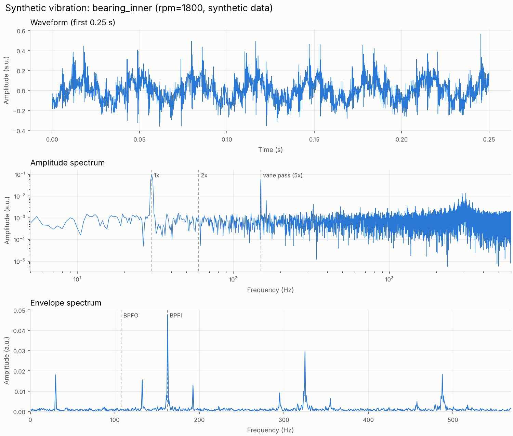

# PumpGuard AI

**An open-source, educational toolkit for centrifugal-pump vibration monitoring: transparent
synthetic signals, physically meaningful features, and leakage-aware data tools, built as a
reproducible foundation for predictive-maintenance and digital-twin research.**


> **Status:** early research prototype. PumpGuard AI does **not** diagnose real equipment and
> is not intended for operational or safety decisions. All bundled signals are **synthetic**.



*Synthetic inner-race defect. The envelope spectrum (bottom) peaks at BPFI with ±1x sidebands,
the classic signature of a defect rotating through the load zone.*

## What's included

- **Synthetic generator** with six conditions (`healthy`, `imbalance`, `misalignment`,
  `bearing_outer`, `bearing_inner`, `cavitation_like`), a vane-pass tone, adjustable severity,
  noise, speed, vane count, resonance and slip. Fully seeded and documented in
  [docs/synthetic-model.md](docs/synthetic-model.md).
- **Bearing kinematics:** BPFO, BPFI, FTF and BSF from geometry (6205 preset included).
- **Features:**
  - *time domain:* RMS, peak, crest factor, kurtosis, skewness, shape/impulse/clearance factors;
  - *frequency domain:* 1x/2x/3x and vane-pass amplitudes, spectral centroid, high-frequency
    energy ratio;
  - *envelope analysis:* peak ratios at BPFO and BPFI.
- **Leakage-aware datasets:** labelled feature tables built from "virtual machines", plus a
  group-based train/test split.
- **Works on your own data:** analyse any `time_s, vibration` CSV from the command line.
- **Provenance:** every synthetic file gets a JSON sidecar with `"synthetic": true` and the full
  generator configuration.
- **Engineering hygiene:** 105 tests (analytic checks, not just smoke tests), CI on
  Linux/Windows/macOS for Python 3.10–3.13, ruff, strict mypy, pre-commit.

## Quick start

```bash
git clone https://github.com/ymesbah-blip/-PumpGuard-AI.git
cd -PumpGuard-AI
python -m venv .venv
# Windows: .venv\Scripts\activate    macOS/Linux: source .venv/bin/activate
pip install -e .
pumpguard demo --condition bearing_outer
```

This prints the features and writes `outputs/bearing_outer_signal.{csv,json,png}`. The
older form `python -m pumpguard.demo --condition healthy` still works.

## Command line

```bash
pumpguard demo --condition misalignment --rpm 2950 --severity 0.7 --seed 1
pumpguard features path/to/recording.csv --rpm 1480 --bearing 6205   # your own data
pumpguard dataset --machines 4 --segments 5 --out outputs/features.csv
pumpguard bearing --rpm 1800                                         # BPFO, BPFI, FTF, BSF
pumpguard bearing --rpm 1800 --n-elements 8 --ball-mm 7.1 --pitch-mm 33.5
pumpguard --help
```

`features` reads a CSV with columns `time_s` and `vibration`. It takes the sampling rate from
`--fs`, then the JSON sidecar, then the time column. Without `--rpm`, shaft-order and bearing
features are skipped.

## Python API

```python
from pumpguard import SignalConfig, simulate, extract_all_features
from pumpguard.dataset import make_synthetic_dataset, group_train_test_split

sig = simulate(SignalConfig(condition="bearing_inner", rpm=1800, severity=0.8, seed=7))
feats = extract_all_features(sig.x, sig.fs, rpm=1800, n_vanes=5, bearing=sig.config.bearing)
print(round(feats["env_bpfi_ratio"], 1), sig.metadata()["synthetic"])

df = make_synthetic_dataset(machines_per_condition=4, segments_per_machine=5, seed=0)
train, test = group_train_test_split(df, test_fraction=0.25)  # no machine in both sets
```

## Which feature reveals which condition?


On this synthetic data, RMS (the basis of the toy health score) flags imbalance and
misalignment but barely moves for bearing defects. Kurtosis and the envelope ratios catch the
bearing defects, and the 2x amplitude singles out misalignment. Reproduce the figure with
`python examples/compare_conditions.py`. The signals were designed to show these patterns, so
this is a teaching result, not evidence of real-world performance.

| Condition | Main synthetic signature | Most telling features |
|---|---|---|
| imbalance | strong 1x | `amp_1x`, `rms` |
| misalignment | 2x larger than 1x | `amp_2x` |
| bearing_outer | impacts at BPFO | `env_bpfo_ratio`, `kurtosis` |
| bearing_inner | impacts at BPFI, modulated at 1x | `env_bpfi_ratio` |
| cavitation_like | bursty broadband 2–5 kHz | `hf_energy_ratio` |

## Project structure

```text
pumpguard-ai/
├── src/pumpguard/          # the package (see docs/architecture.md)
├── tests/                  # pytest suite
├── examples/               # runnable scripts
├── docs/                   # model description, architecture, dataset/model card templates
├── data/                   # local datasets (not committed)
├── notebooks/              # exploratory work
├── .github/                # CI, release workflow, issue/PR templates
├── pyproject.toml          # metadata, dependencies, tool configuration
├── CHANGELOG.md  ROADMAP.md  CONTRIBUTING.md  CODE_OF_CONDUCT.md  SECURITY.md  CITATION.cff
└── LICENSE
```

## Data and reproducibility

The included generator is **synthetic** and no substitute for measured machine data. Every
random draw is seeded, and identical configurations give identical signals (tested). When you
use real datasets, fill in a [dataset card](docs/dataset-card-template.md): source, license,
machine configuration, sampling rate, sensor location and labelling method. Always split by
machine or recording (`group_id`), never by segment, or reported accuracy will be inflated.

## Roadmap

v0.3 adds the first public dataset loader, v0.4 baseline models with leakage-safe evaluation,
v0.5 robustness and explainability, and v0.6 a digital-twin prototype. Details and good first
issues are in [ROADMAP.md](ROADMAP.md).

## Research questions

- Which vibration features distinguish operating conditions in a centrifugal-pump dataset?
- How do the features and baselines behave as noise, speed and fault severity vary?
- Can a lightweight digital twin combine measured signals with a simplified physical model?
- How much do data leakage and class imbalance inflate reported diagnostic performance?

## Contributing

Issues and pull requests are welcome. Start with [CONTRIBUTING.md](CONTRIBUTING.md). In short:
include reproducible examples and tests, state your engineering assumptions, and make no claim
of real-world accuracy without validation.

## Citation

If you use PumpGuard AI in research, please cite it using [CITATION.cff](CITATION.cff).

## License

MIT. See [LICENSE](LICENSE).
