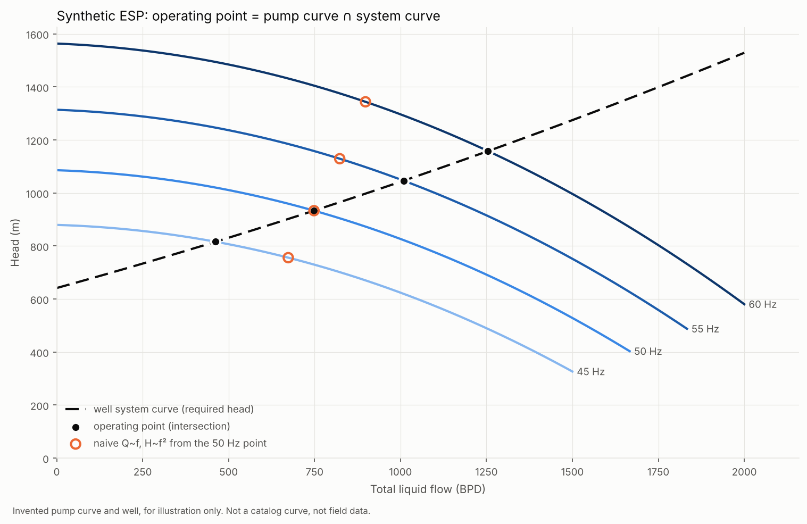

# Pump operating point, orders and sensors (ESP focus)

Modules: `pumpguard.units`, `pumpguard.hydraulics`, `pumpguard.orders`, `pumpguard.sensors`,
`pumpguard.regime`, `pumpguard.datasets.scada`. Everything is in SI units internally; convert
oilfield units at the boundary (`bpd_to_m3s`, `ft_to_m`, `bar_to_pa`, ...).

> Synthetic sweeps use an **invented** pump curve and well (`illustrative_esp`,
> `illustrative_well`). For real work, build the curve from the manufacturer's catalog points
> and the system from well data, and record their sources.

## 1. Operating point = pump curve ∩ system curve



**Pump curve** (`PumpCurve`): catalog head per stage vs flow at a reference speed (ESP catalogs
are usually given at 60 Hz ≈ 3500–3600 rpm, water, SG = 1), fitted with a low-degree polynomial.
The fit must decrease with flow so it can be inverted. For `n_stages` stages at speed N:

    H_pump(Q, N) = n_stages · (N/N0)² · h_stage(Q · N0/N)

**System curve** (`WellSystem`): what the well asks of the pump at flow Q:

    p_intake(Q)    = p_r − Q/PI − Δp_datum→intake        (linear IPR)
    p_discharge(Q) = p_wh + ρ g L + k Q²                  (wellhead + static lift + friction)
    H_required(Q)  = (p_discharge − p_intake) / (ρ g)

**Operating point** (`solve_operating_point`): the flow where H_pump(Q, N) = H_required(Q). The
solver uses Brent's method, refuses to extrapolate beyond the catalog range, and raises
`OperatingPointError` when the pump cannot lift at that speed.

### Why "Q ∝ f, Δp ∝ f²" from one measured point is wrong in a well

The affinity laws move a point along the pump's own curve family. The operating point moves
along the system curve, which has a large static term (ρ g L) and an inflow term. Scaling one
measured point with Q ∝ f and Δp ∝ f² is only valid for a system curve that is a parabola
through the origin, i.e. pure friction with no lift. In a well it gives points that the well
cannot sustain: the required discharge pressure (wellhead + hydrostatic + friction) barely
changes with frequency, while the naive projection makes it grow with f².
`naive_affinity_projection` quantifies the gap (`system_head_gap_m`).

A simple consistency check for any study that projects to other frequencies: compute
p_discharge − p_wellhead at each frequency. It should change only by the friction term (∝ Q²).
If it scales with f², the projection ignored the system curve.

### Other hydraulic quantities

- `head_from_pressure(Δp, ρ)`: H = Δp / (ρ g). Use the actual mixture density (or SG × ρ_water).
  A single fitted SG that makes the model match production also absorbs friction, gas and
  instrument offsets. Report it as a calibration factor, not as fluid density.
- `hydraulic_power_w(Q, H, ρ)` = ρ g Q H; `OperatingPoint.efficiency` = hydraulic / shaft power,
  only when shaft power is measured. Efficiency > 1 is rejected as inconsistent data.
- `npsh_available_m(p_abs, p_vapour, ρ)`: single-phase NPSHa. Below the bubble point the
  limiting phenomenon in an ESP is free gas (gas interference, gas lock), which NPSH does not
  describe.

## 2. Mechanism vs sensor

**Mechanism** (`orders.py`): what the machine does.
`rpm_from_supply_frequency(f, poles=2, slip)` gives rpm = 120 f / p × (1 − slip);
`shaft_hz(rpm)` = rpm/60; `vane_pass_hz(rpm, n_vanes)` = n_vanes × f1. The impeller vane count
must come from the pump drawing. Energy at 1x or vane pass exists in every healthy pump and is
**not** fault evidence by itself.

**Sensor** (`sensors.py`): what an instrument can see. A component is observable only below
Nyquist, below the anti-alias cutoff, and with a ≥ 2.56× sampling margin (`resolvable`,
`sampling_report`). `measure()` simulates anti-alias filtering, decimation, clipping and
quantisation.

| Channel | Sample rate | 1x (≈ 43 Hz) | Vane pass (≈ 300 Hz) | Bearing defects |
|---|---|---|---|---|
| SCADA vibration, one value per minute | 1/60 Hz | not observable | not observable | not observable |
| IEPE accelerometer, 25.6 kHz, 10 kHz anti-alias | 25.6 kHz | observable | observable | observable up to 10 kHz |

So SCADA vibration trends can show **level changes** (and correlate with speed, which drives
them). They cannot show *which* mechanism changed. Order or envelope analysis needs a
high-rate accelerometer and a speed reference ([lab rig plan](lab-rig-plan.md)).

## 3. SCADA trend data

`load_scada_csv(path, ScadaSchema(...))` declares the quantity and logged unit of every column,
converts to SI, rejects non-finite values (or drops and reports them), sorts timestamps, drops
duplicates, checks the logging interval and reports gaps.

`time_block_split(data, block="1D")` splits by whole days, with the last days held out by
default and an optional embargo. Consecutive one-minute records are nearly identical. A
random record-level 70/15/15 split puts near-duplicates on both sides and measures
memorisation, not generalisation.

## 4. Limits (state them with any result)

Single-phase liquid; no viscosity or gas correction of the pump curve; affinity laws as
approximations; linear IPR; constant density along the tubing; no transient behaviour; no
motor or cable model. **No cavitation or gas-lock classification** is claimed anywhere in
PumpGuard: that requires controlled experiments (see the rig plan). Nothing here is a
recommendation for operating field equipment.

## Example

```python
from pumpguard.hydraulics import PumpCurve, WellSystem, solve_operating_point
from pumpguard.orders import rpm_from_supply_frequency
from pumpguard.units import bpd_to_m3s, ft_to_m, bar_to_pa

pump = PumpCurve(
    flow_m3_s=tuple(bpd_to_m3s(q) for q in catalog_bpd),  # from the catalog
    head_m_per_stage=tuple(ft_to_m(h) for h in catalog_ft_per_stage),
    reference_speed_rpm=3600.0,
    n_stages=n_stages,
    degree=3,
    bep_flow_m3_s=bpd_to_m3s(bep_bpd),
    source="manufacturer catalog, model/rev/date",
)
well = WellSystem(
    reservoir_pressure_pa=bar_to_pa(p_r_bar),
    productivity_index_m3_s_per_pa=bpd_to_m3s(pi_bpd_per_bar) / bar_to_pa(1),
    wellhead_pressure_pa=bar_to_pa(p_wh_bar),
    lift_height_m=tvd_intake_to_wellhead_m,
    density_kg_m3=mixture_density,
    friction_pa_per_m3s2=k_friction,
)
res = solve_operating_point(pump, well, rpm_from_supply_frequency(50.0, slip=0.03))
```

Full synthetic example: `python examples/esp_operating_regime.py`.
