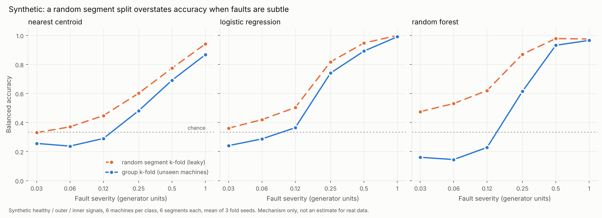

# Leakage experiment: random split vs group split

Roadmap v0.4 research question: **how much does a record-level random split overstate a
model's score, compared with a split that keeps each machine, bearing or recording day on one
side?**

Module `pumpguard.leakage`, CLI `pumpguard leakage`, figure script
`examples/leakage_experiment.py`.

## Method

For each repeat `r` (fold seed and model seed `seed + r`) the same model, features and labels
are evaluated twice:

| Split | What is tested | Function |
|---|---|---|
| group k-fold | each group by a model that never saw it | `stratified_group_kfold` |
| random k-fold | shuffled segments, ignoring groups | `random_kfold` |

`inflation = random − group` (balanced accuracy). `k` is capped by the smallest number of
groups in any class. Models: `nearest_centroid` (core), `logistic_regression` and
`random_forest` (`[ml]` extra, fixed hyperparameters from
[protocol amendment 1](benchmark-protocol.md#amendment-1-learned-models-v04-2026-11-21-before-any-real-result)).

```bash
pumpguard leakage --synthetic                          # subtle synthetic faults (severity 0.05-0.15)
pumpguard leakage outputs/pu_real3.csv --repeats 10    # your feature table (label, group_id columns)
python examples/leakage_experiment.py                  # sweep over fault severity, writes a figure
```

Each run writes `leakage.json` (every repeat) and `leakage.md`.

## Why synthetic machines leak

In `make_synthetic_dataset` every virtual machine gets its own speed (1450–3000 rpm) and noise
level, and its segments differ only by a 0.5 % speed drift and the noise realisation. Features
such as `rms`, `spectral_centroid_hz` and `hf_energy_ratio` therefore carry a machine
fingerprint that has nothing to do with the fault. Real data have the same structure for other
reasons: mounting, sensor coupling, the individual defect geometry, the day of recording.

## Synthetic result (mechanism only)



Healthy / outer / inner race, 6 machines per class, 6 segments of 0.5 s each, severity drawn per
machine from 0.5–1.5 × the level shown, 5-fold, mean of 3 fold seeds, PumpGuard 0.3.0:

| Severity | Nearest centroid group / random | Logistic regression group / random | Random forest group / random |
|---|---|---|---|
| 0.03 | 0.256 / 0.330 | 0.241 / 0.361 | 0.160 / 0.475 |
| 0.06 | 0.238 / 0.370 | 0.287 / 0.420 | 0.145 / 0.531 |
| 0.12 | 0.290 / 0.448 | 0.364 / 0.503 | 0.228 / 0.620 |
| 0.25 | 0.481 / 0.602 | 0.741 / 0.818 | 0.614 / 0.870 |
| 0.5 | 0.691 / 0.775 | 0.892 / 0.948 | 0.932 / 0.978 |
| 1 | 0.867 / 0.941 | 0.991 / 1.000 | 0.966 / 0.975 |

Chance balanced accuracy is 0.333.

What this shows, for this generator only:

- **The gap is largest when the fault is subtle.** With strong faults every split finds them and
  inflation is small. With subtle faults the random forest reaches 0.53–0.62 on a random split
  while scoring *below chance* on unseen machines. A random-split report would claim a working
  diagnostic where there is none.
- **Flexible models exploit the fingerprint most.** At low severity the random forest's
  inflation (+0.32 to +0.39) is two to three times that of logistic regression or the nearest
  centroid.
- **Below-chance group scores are a symptom, not a finding.** When features identify machines
  but carry little transferable class information, holding out whole machines leaves the
  training fold short of the held-out class and pushes predictions away from it. Read it as "no
  evidence of generalisation".

What this does **not** show: the size of the gap on any real dataset. The numbers depend on
the generator's machine-to-machine spread, the number of machines and the segment length. On
real data, run `pumpguard leakage` on the actual feature table and report only the group
column as performance.

## Real data: Paderborn `real3`

15 bearings (5 per class), 1 196 recordings, 4 765 one-second segments, diagnosis task,
10 fold seeds ([report](results/paderborn-real3/leakage_report.md)):

| Model | Group k-fold | Random k-fold | Inflation [min, max] |
|---|---|---|---|
| `nearest_centroid` | 0.575 | 0.620 | +0.044 [+0.019, +0.065] |
| `logistic_regression` | 0.579 | 0.796 | +0.218 [+0.186, +0.266] |
| `random_forest` | 0.525 | 0.994 | +0.469 [+0.383, +0.504] |

The synthetic mechanism appears in measured data. A random forest scores 0.99 when segments
of every bearing sit on both sides, and 0.53 when whole bearings are held out. Its top features
(`hf_energy_ratio`, `spectral_centroid_hz`, `rms`) describe each bearing's broadband level, not
its defect frequencies. Report only the group column.

## Checks for any study

1. Is every split by the unit that carries shared information (machine, bearing, recording day)?
   One-minute SCADA records split at random fail this; see `time_block_split`.
2. Run the same model with both splits. A large positive gap means the random-split number
   measures memorisation.
3. Were hyperparameters or features chosen on the test folds? That is leakage too, even with a
   group split.
4. Are labels derived from the model's own inputs (for example a threshold on a measured
   variable)? Then a high score reproduces the labelling rule; it does not predict real events.
