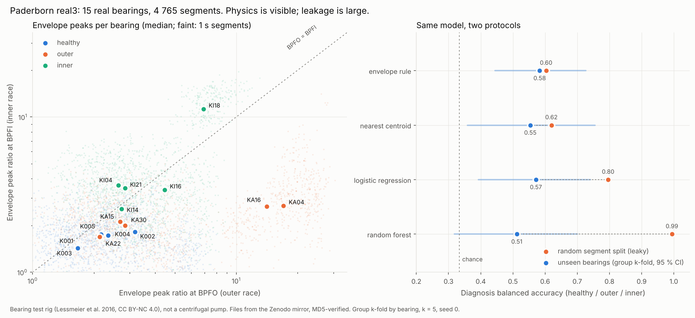

# Paderborn `real3`: first results on measured data

Run on 2026-11-21 with PumpGuard 0.3.0 plus the v0.4 work (learned models, leakage experiment),
under the [benchmark protocol](../../benchmark-protocol.md) and its amendment 1. Nothing in the
protocol changed after these numbers existed.

> **Bearing test rig, not a pump.** Lessmeier et al. (2016), KAt-DataCenter, Paderborn
> University, CC BY-NC 4.0. These results describe bearing-damage signatures on one rig. They
> say nothing about diagnosing centrifugal pumps in the field.



## Answers to the protocol's questions

1. **Detection** (healthy vs damaged, on bearings the model never saw): the best baseline,
   a single threshold on `spectral_centroid_hz`, reaches balanced accuracy **0.766**
   [0.60, 0.92]. The envelope physics rule reaches 0.691 [0.56, 0.79]. Chance is 0.500.
2. **Diagnosis** (healthy / outer / inner): the envelope rule reaches **0.583** [0.44, 0.73],
   nearest centroid 0.554 [0.36, 0.75]. Chance is 0.333.
3. **Leakage:** a random segment split lifts the random forest from 0.512 to **0.994** in
   diagnosis. Over 10 fold seeds its inflation stays between +0.38 and +0.50.
4. **Learned models:** neither logistic regression nor the random forest beats every baseline
   under the decision rule. Neither counts as an improvement.

Question 4 of the protocol (transfer from artificial to real damage) needs the
`artificial_to_real` archives and is not answered here.

## Data and checks

| Item | Value |
|---|---|
| Source | Zenodo mirror, DOI [10.5281/zenodo.15845309](https://zenodo.org/records/15845309) |
| Archives | 15 of 15 match Zenodo's size and MD5 (checked twice on the user's machine: Windows `Get-FileHash`, Linux `hashlib`) |
| Inventory | 15 bearings × 4 operating conditions × 20 measurements = 1 200 files, none missing |
| Used | 1 196 files, 4 765 one-second segments (healthy 1 594, outer 1 589, inner 1 582) |
| Rejected | 4 files: `K002/N15_M01_F10_K002_10`, `KI16/N15_M01_F10_KI16_4`, `KI16/N15_M07_F04_KI16_1`, `KI16/N15_M07_F04_KI16_16`. Their vibration channel holds 4.49–4.67 s of samples at the documented 64 kHz while the 4 kHz channels in the same files hold exactly 4.000 s, so the vibration rate in them is unknown. The duration check, fixed before any result, rejected them. |
| Speed | Measured `speed` channel used for all 1 196 files (all within ±20 % of nominal) |
| Labels | Bearing code per the publication. Fact sheets confirm mode, ring and extent for all 10 damaged bearings. **KI04 and KI14 also carry an outer-ring indentation** ("multiple damage") and keep the label `inner`. |

Full provenance: [`feature_table_provenance.json`](feature_table_provenance.json),
[`paderborn_verification.json`](paderborn_verification.json).

## Results

Balanced accuracy on unseen bearings (stratified group k-fold by bearing, k = 5, seed 0) with
95 % intervals from 1 000 bootstrap draws over bearings. The last two columns show the same
model under a random segment split. Never quote that column as performance.

**Detection**

| Model | Kind | Unseen bearings [95 % CI] | Macro-F1 | Random split | Inflation |
|---|---|---|---|---|---|
| `majority_class` | baseline | 0.500 [0.50, 0.50] | 0.400 | n/a | n/a |
| `single_feature_threshold` | baseline | 0.766 [0.60, 0.92] | 0.759 | 0.830 | +0.064 |
| `envelope_rule` | baseline | 0.691 [0.56, 0.79] | 0.684 | 0.716 | +0.025 |
| `logistic_regression` | learned | 0.739 [0.50, 0.90] | 0.728 | 0.919 | +0.179 |
| `random_forest` | learned | 0.699 [0.48, 0.90] | 0.701 | 0.994 | +0.295 |

**Diagnosis**

| Model | Kind | Unseen bearings [95 % CI] | Macro-F1 | Random split | Inflation |
|---|---|---|---|---|---|
| `majority_class` | baseline | 0.331 [0.17, 0.50] | 0.238 | n/a | n/a |
| `envelope_rule` | baseline | 0.583 [0.44, 0.73] | 0.589 | 0.603 | +0.020 |
| `nearest_centroid` | baseline | 0.554 [0.36, 0.75] | 0.550 | 0.620 | +0.065 |
| `logistic_regression` | learned | 0.572 [0.39, 0.74] | 0.571 | 0.796 | +0.224 |
| `random_forest` | learned | 0.512 [0.32, 0.70] | 0.513 | 0.994 | +0.482 |

Leakage experiment, diagnosis, 10 fold seeds ([`leakage_report.md`](leakage_report.md)):

| Model | Group k-fold mean | Random k-fold mean | Inflation [min, max] |
|---|---|---|---|
| `nearest_centroid` | 0.575 | 0.620 | +0.044 [+0.019, +0.065] |
| `logistic_regression` | 0.579 | 0.796 | +0.218 [+0.186, +0.266] |
| `random_forest` | 0.525 | 0.994 | +0.469 [+0.383, +0.504] |

Confusion matrices, fitted rules per fold and per-bearing accuracy:
[`benchmark_report.md`](benchmark_report.md) and [`benchmark_results.json`](benchmark_results.json).

## Failure modes

- **900 rpm.** The envelope rule drops to 0.469 in detection and 0.418 in diagnosis at
  `N09_M07_F10`, against 0.76–0.77 and 0.60–0.67 at 1 500 rpm. Defect impacts carry less energy
  at low speed, and the protocol keeps the demodulation band fixed (6.4–25.6 kHz).
- **Faint outer-race damage.** KA15 and KA30 (plastic indentations) and KA22 (small pitting)
  sit inside the healthy cluster in the figure. Nearest centroid classifies none of their
  segments as outer.
- **Inner-race bearings called outer.** The envelope rule labels 517 of 1 582 inner-race
  segments as outer. KI14 has the outer-ring indentation from its fact sheet; KI16 shows a BPFO
  peak (4.45) above its BPFI peak (3.39) although its fact sheet lists only inner-ring damage.
- **Healthy bearings that look damaged.** K001–K003 have median kurtosis 15–17, higher than every
  damaged bearing (the highest, KI18, has 10.0). Kurtosis-based rules fail on them; the threshold baseline chose
  `spectral_centroid_hz` instead and then misses K004 and K005.

## What the learned models learned

Both models lean hardest on `hf_energy_ratio`: it carries the largest logistic weight in the first
fold and the top random-forest importance, followed for the forest by `spectral_centroid_hz` and
`rms`. Amendment 1 flags this: those features describe the broadband level of each bearing and
its mounting, not the defect frequencies. A random split
rewards them because every bearing contributes segments to both sides. On unseen bearings the
advantage disappears, and the random forest falls below the one-parameter envelope rule.

## Decision under the protocol

- No learned model is meaningfully better than every baseline (lower 95 % bound vs baseline
  point estimate). The transparent baselines stay the reference on this rig.
- `envelope_rule` (0.583) beats `nearest_centroid` (0.554) on `real3`. By the protocol's rule,
  the physics rule suffices on this rig and extra model complexity needs a new justification.
  The difference between the two is not meaningful (0.44 lower bound vs 0.554).
- Fifteen bearings give intervals about ±0.15 wide. Differences below that size are noise.

## What would change these numbers legitimately

Each item needs a protocol amendment written **before** it runs, with the earlier results kept
next to the new ones:

1. Select the envelope band on training folds only (spectral kurtosis or kurtogram, roadmap
   v0.5). The 900 rpm failure points here first.
2. Order tracking with the measured speed channel, so features at 900 and 1 500 rpm become
   comparable.
3. Run `artificial_to_real` (13 more archives; KA08 is absent from the mirror) to answer
   question 4.
4. Add a second rig before claiming that any conclusion transfers.

Tuning features, bands or hyperparameters on these 15 bearings and reporting the best score
would turn this benchmark into another leaky result.

## Reproduce

```bash
pumpguard paderborn verify   data/paderborn --archives data/paderborn/archives
pumpguard paderborn features data/paderborn --task real3 --out outputs/pu_real3.csv
pumpguard benchmark outputs/pu_real3.csv --out outputs/bench_real3_baselines
pumpguard benchmark outputs/pu_real3.csv --learned --out outputs/bench_real3
pumpguard leakage   outputs/pu_real3.csv --repeats 10 --out outputs/leak_real3
python examples/paderborn_real3_figure.py --features outputs/pu_real3.csv \
    --bench outputs/bench_real3/results.json --out docs/images/paderborn_real3.png
```

The baseline rows were identical in the runs with and without `--learned`. The feature table
itself is not committed (derived from CC BY-NC data); regenerate it from the files.
